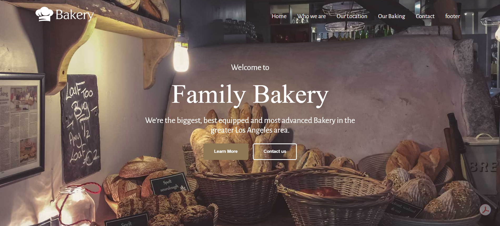

# Bakery Website Template — HTML & CSS

A bakery website template built using **pure HTML5 and CSS3**, inspired by the original Bakery website design. The project features a complete multi-section layout with a navigation bar, bakery information, product showcases, contact details, and an embedded Google Map.

## 🌐 Live Demo

[**View the Deployed Website**](https://abdelrahmankishk.github.io/Bakery-Template/)



---

## 📌 Project Overview

The Bakery Website is a single-page website template designed to present a bakery's brand, introduce its story, showcase baked goods, and provide visitors with location and contact information.

The implementation recreates the visual layout of the original design while using HTML and CSS to structure the content, build multi-column layouts, style the navigation, and create a consistent visual experience across sections.

## ✨ Key Features

- **Navigation Bar:** Section-based navigation links for accessing different parts of the website.
- **Hero Section:** A full-screen background image, centered introduction, and call-to-action buttons.
- **Who We Are:** An introduction section with an image, descriptive content, and icon-based information.
- **Our Location:** A dedicated section combining descriptive text with an image.
- **Our Baking:** A three-column product showcase featuring Superior Breads, Bagels, and Cookies.
- **Contact Information:** Contact details, location information, and an embedded Google Map.
- **Information Footer:** Multi-column layout containing bakery information, highlights, opening hours, and contact details.
- **Social Media Icons:** A footer section displaying social platform icons.
- **Smooth Section Navigation:** CSS-based smooth scrolling between linked sections.
- **Screens Responsive :** Add responsive layouts and media queries for mobile phones and tablets

## 🛠️ Technologies & Tools

| Technology        | Purpose                                                        |
| ----------------- | -------------------------------------------------------------- |
| HTML5             | Structuring the website and organizing its content             |
| CSS3              | Styling, layouts, spacing, typography, and visual presentation |
| Google Fonts      | Custom typography using Alegreya Sans                          |
| Google Maps Embed | Displaying the location within the contact section             |
| GitHub Pages      | Hosting and deploying the website                              |

**No JavaScript or CSS frameworks are used in this implementation.**

## 💡 Technical Highlights

This project demonstrates practical use of core front-end development techniques:

- Structuring a multi-section webpage with HTML.
- Separating page structure and presentation using an external CSS stylesheet.
- Creating multi-column layouts using CSS `float`.
- Using a reusable `.container` class to maintain consistent horizontal alignment.
- Clearing floated elements with a reusable `.clr` utility class.
- Styling hero sections with background images, `background-size`, and `background-position`.
- Using Flexbox to align icons and text within selected components.
- Applying typography, spacing, borders, colors, and image sizing consistently across sections.
- Implementing smooth in-page scrolling with the CSS `scroll-behavior` property.
- Embedding a Google Map using an HTML `iframe`.

## 📂 Project Structure

```text
Bakery-Template/
│
├── index.html
│
├── css/
│   └── style.css
│
└── images/
    ├── Website images and logos
    │
    └── Icons/
        └── Section, contact, and social media icons
```

## 🚀 Run Locally

To run the project on your local machine:

1. Clone the repository:

   ```bash
   git clone https://github.com/Abdelrahmankishk/Bakery-Template.git
   ```

2. Navigate to the project directory:

   ```bash
   cd Bakery-Template
   ```

3. Open `index.html` in your browser.

No package installation, build process, or development server is required.

You can also explore the [live demo](https://abdelrahmankishk.github.io/Bakery-Template/) directly.

## 📈 Potential Future Enhancements

- Refactor float-based layouts using Flexbox and CSS Grid where appropriate.
- Improve HTML semantics, accessibility, and consistent styling conventions.
- Replace demonstration content and contact information with customized details.
- Connect call-to-action buttons and social media icons to their intended destinations.
- Optimize images and other assets to improve loading performance.

## 🎨 Design Inspiration

This project was inspired by the original Bakery website design:

[**View the Original Reference**](https://elnage.github.io/bakery/)

The website is an independent implementation of the reference design, built with HTML and CSS.

---

**Status:** Completed and deployed using GitHub Pages.
